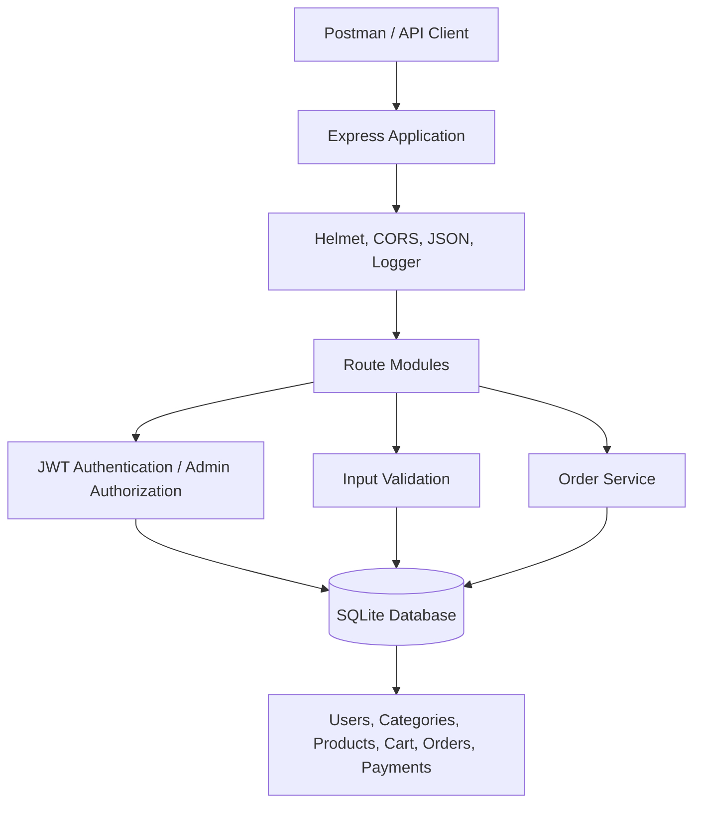

# Architecture

The project follows a small layered Express REST API structure:

## Request lifecycle

1. An API client sends an HTTP request to Express.
2. Common middleware adds security headers, handles CORS, parses JSON, and logs requests.
3. The route validates user-supplied values.
4. Protected routes verify the JWT. Admin routes additionally check the role.
5. Route handlers read or write SQLite data using parameterized statements.
6. Checkout business logic runs inside a database transaction to avoid partial stock updates.
7. The centralized error handler returns a consistent JSON error response.

## Important design decisions

- **SQLite:** One local database file; no separate database server.
- **TypeScript:** Strict compiler settings, typed request user, and shared interfaces.
- **Money:** Integer paise values avoid floating-point currency calculations.
- **Passwords:** Hashed with bcrypt-compatible `bcryptjs`; plaintext passwords are never stored.
- **JWT:** Stateless Bearer-token authentication with customer/admin roles.
- **Inventory:** Cart quantities are checked against stock. Checkout rechecks stock inside a transaction and decrements it only for an approved simulated payment.
- **Order history:** Order items store product-name, SKU, and price snapshots so later catalog changes do not rewrite past purchases.
- **Soft deletion:** Product deletion hides the item without removing order history.
- **Payment simulation:** Only test tokens are supported; no real payments or card data are handled.
