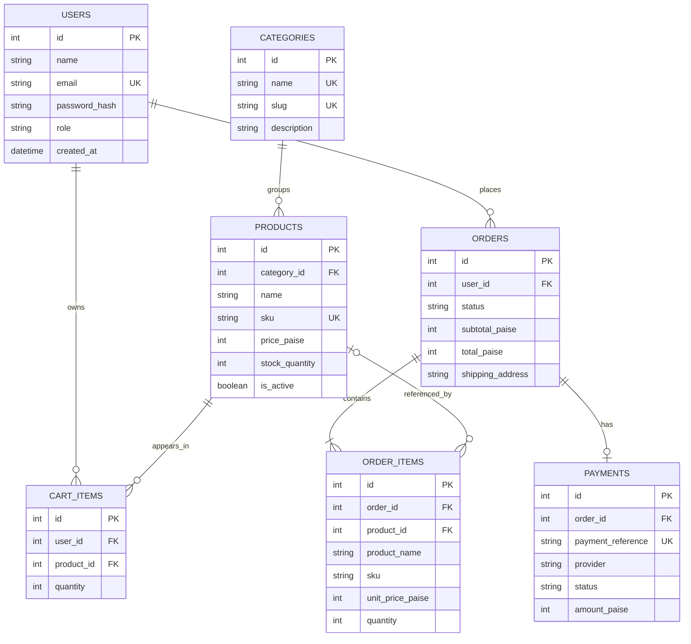

# Entity Relationship Diagram

`ORDER_ITEMS.product_id` can become `NULL` if the referenced product is deleted, while the product name, SKU, and unit-price snapshot remain available for order history. In normal catalog operations products are soft-deleted rather than physically deleted.
